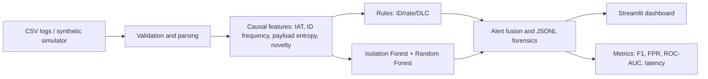

# CAN-Sentinel: Automotive ECU Intrusion Detection System

A modular demonstration IDS for **offline CAN 2.0B log analysis and synthetic traffic**. It combines deterministic rules, an Isolation Forest / Random Forest ensemble, JSONL forensic alerts, and a Streamlit analysis dashboard.

> **Safety and scope:** This is not a certified automotive security product and is not hard-real-time software. Traffic generation is in-memory only; no code in this repository opens or transmits to a vehicle bus. Never inject packets into a road vehicle. Use authorized datasets and isolated test benches.

## Architecture



## Automotive security background
Classic CAN prioritizes frames through arbitration identifiers, but the identifier is not an authenticated sender identity. A compromised node can therefore impersonate another ECU, and high-priority traffic can impair lower-priority messages. This project demonstrates observable anomalies—unexpected ID rates, use of configured reserved IDs, unusual payload/timing patterns—but does not establish a production allowlist, cryptographic authenticity, or vehicle-specific safety constraints.

## Requirements and installation

Python 3.10+ is recommended.

```bash
python -m venv .venv
source .venv/bin/activate       # Windows: .venv\\Scripts\\activate
python -m pip install --upgrade pip
pip install -r requirements.txt
```

## Launch dashboard

```bash
streamlit run app.py
```

Choose `dos`, `fuzzy`, or `spoof`, select a reproducible seed, then run the scenario. The view includes a timestamp/ID plot, packet inspector, alert feed, ROC curve, classification metrics, and measured latency.

## Python usage

```python
from can_sentinel.simulator import TrafficSimulator
from can_sentinel.detector_ml import MLDetector
from can_sentinel.engine import IDSEngine
from can_sentinel.evaluator import evaluate

frames = TrafficSimulator(seed=7).scenario(500, 100, "dos")
model = MLDetector(seed=7).fit()
engine = IDSEngine(model, "output/alerts.jsonl")
print(evaluate(frames, engine))
```

CSV ingestion expects headers `Timestamp,Arbitration_ID,DLC,Data_Bytes`; optional `Label` may provide ground truth. IDs may be decimal or `0x`-prefixed. Data bytes accept contiguous hex or whitespace/colon-delimited hex. DLC must match data length and be 0–8.

## Attack generators

- `TrafficSimulator.dos(count)`: dominant `0x000` frames at 10x the configured baseline rate.
- `TrafficSimulator.fuzzy(count)`: random standard IDs `0x000`–`0x7FF` and eight random payload bytes.
- `TrafficSimulator.spoof(count)`: implausible 7000–9999 RPM payloads on `0x316`.

The simulator is seeded and does not use python-can to transmit. `python-can` is listed for interoperability extensions, but no live adapter is enabled.

## Detection and evaluation
Rule checks cover DLC bounds, configured reserved identifiers (`0x000` by default), aggregate bus rate and per-ID rate. Statistical features are causal per frame: inter-arrival time, sliding-window ID frequency, payload Shannon entropy, DLC, numeric identifier, ID novelty, and raw `0x316` RPM. ML is trained reproducibly using generated benign and attack samples. The Isolation Forest and supervised Random Forest ensemble is a **demonstration model**, not a general zero-day guarantee.

Metrics include accuracy, precision, recall, F1, false-positive rate, ROC-AUC where both labels exist, mean latency and p95 latency. Latency is host/process dependent and is not a real-time guarantee. Synthetic train/test distributions overlap by design; meaningful generalization requires independently captured, representative, vehicle-authorized traces and leakage-safe splits.

## Forensic output and report
Alerts append to JSON Lines, one JSON object per event, with event/frame timestamps, ID, severity, rule, details, ML score, and measured processing duration. Generate the project summary and vulnerability table:

```bash
python generate_report.py
python generate_report.py --pdf
```

## Repository map

```text
can_sentinel/       simulator, parser/features, rules, ML, pipeline, evaluator
app.py              Streamlit dashboard
 generate_report.py Markdown/PDF summary generator
requirements.txt    Python dependencies
```
